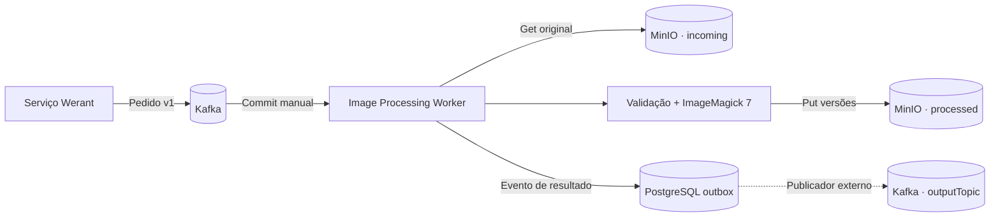

<div align="center">

# WERANT

### Image Processing Worker

**Seguro. Idempotente. Orientado a eventos.**

Processamento assíncrono de imagens para o ecossistema Werant.

<br />

[](https://go.dev/)
[](https://kafka.apache.org/)
[](https://min.io/)
[](https://www.postgresql.org/)

<br />


</div>

---

## Visão geral

`werant-image-processing-worker` é um worker Go que consome pedidos do Kafka,
valida imagens não confiáveis, gera as versões solicitadas com ImageMagick e
registra o resultado em uma outbox PostgreSQL.

Os binários permanecem fora do Kafka. A mensagem transporta o contrato e a
chave do objeto; o original é lido do bucket de entrada e as versões são
gravadas no bucket processado configurado.

A implementação atual fornece:

- consumo serial com commit manual e rebalance bloqueado durante o trabalho;
- validação do envelope, do contrato v1 e das chaves de objeto;
- detecção de JPEG, PNG, GIF e WebP pelo conteúdo;
- limites de bytes, pixels, frames, tempo, memória e disco;
- crop centralizado, redução proporcional e conversão por versão;
- preservação de GIF e WebP animado quando a saída é WebP;
- armazenamento S3-compatible com buckets separados;
- outbox PostgreSQL com deduplicação e lock por imagem;
- compensação de uploads quando a persistência falha;
- testes unitários, testes reais com ImageMagick e validação contínua.

> [!NOTE]
> Este repositório não publica eventos no Kafka. Ele persiste o resultado e o
> `output_topic` na outbox; um publicador externo é responsável pela entrega.

## Arquitetura

### Fluxo de processamento



O processamento de cada registro segue estas etapas:

1. validar a sintaxe JSON e os dados necessários para roteamento;
2. adquirir o lock PostgreSQL do `imageId` e procurar um resultado anterior;
3. validar o contrato, o formato detectado e os limites do arquivo;
4. gerar localmente todas as versões antes de iniciar os uploads;
5. gravar os artefatos no bucket processado;
6. persistir o evento de sucesso ou rejeição na outbox;
7. remover o original e confirmar o offset Kafka somente após a conclusão.

Falhas de infraestrutura interrompem o consumer sem confirmar o registro.
Falhas definitivas do conteúdo geram um evento `IMAGE_PROCESSING_FAILED`.

### Componentes

| Componente | Responsabilidade |
| :-- | :-- |
| Kafka | Receber pedidos e controlar a entrega por offset |
| MinIO incoming | Armazenar o arquivo original até a conclusão |
| ImageMagick 7 | Recortar, redimensionar, compor animações e codificar saídas |
| MinIO processed | Armazenar as versões finais |
| PostgreSQL | Serializar trabalho por imagem, deduplicar e manter a outbox |
| Publicador externo | Publicar o `payload` da outbox no `output_topic` |

## Estrutura do repositório

```text
.
├── .github/workflows/ci.yml          # Qualidade, testes e vulnerabilidades
├── application
│   ├── ports                         # Contratos de storage, processor e outbox
│   └── usecases                      # Orquestração e compensação do pipeline
├── cmd/worker/main.go                # Entry point do worker
├── domain
│   ├── patterns                      # Limites operacionais e formatos
│   ├── image.go                      # Pedido, resultado e validações
│   └── outbox.go                     # Entidade da outbox
├── infrastructure
│   ├── config                        # Configuração por ambiente
│   ├── dto                           # Desserialização do contrato Kafka
│   ├── messenger                     # Cliente e consumer Kafka
│   ├── processing                    # Inspeção, crop e ImageMagick
│   ├── storage                       # Adaptadores MinIO e PostgreSQL
│   └── worker                        # Bootstrap e ciclo de vida do processo
├── observability                     # Registro de falhas de limpeza
├── scripts/run-worker.ps1            # Inicialização local no Windows
├── .env.example
├── go.mod
└── go.sum
```

## Configuração

| Variável | Obrigatória | Padrão | Responsabilidade |
| :-- | :--: | :-- | :-- |
| `KAFKA_BROKERS` | Sim | — | Brokers separados por vírgula |
| `KAFKA_TOPICS` | Sim | — | Tópicos de entrada separados por vírgula |
| `MINIO_ENDPOINT` | Sim | — | Endpoint S3-compatible em `host:port` |
| `MINIO_ACCESS_KEY` | Sim | — | Access key do MinIO |
| `MINIO_SECRET_KEY` | Sim | — | Secret key do MinIO |
| `MINIO_SECURE` | Não | `false` | Habilita TLS na conexão MinIO |
| `MINIO_INCOMING_BUCKET_NAME` | Sim | — | Bucket dos arquivos originais |
| `MINIO_PROCESSED_BUCKET_NAME` | Sim | — | Bucket das versões processadas; deve ser diferente do incoming |
| `POSTGRES_URL` | Sim | — | URL de conexão com o banco exclusivo do worker |
| `POSTGRES_USER` | Não | URL | Sobrescreve o usuário presente em `POSTGRES_URL` |
| `POSTGRES_PASSWORD` | Não | URL | Sobrescreve a senha presente em `POSTGRES_URL` |
| `IMAGEMAGICK_BINARY` | Não | `magick` | Nome ou caminho do executável ImageMagick 7 |

Use [.env.example](.env.example) como referência. Não versionar credenciais
reais; `.env` e suas variantes locais são ignorados pelo Git.

## Desenvolvimento local

Requisitos: Go 1.26+, ImageMagick 7 com delegates JPEG/PNG/WebP, PostgreSQL e
Kafka disponíveis, além dos dois buckets MinIO já criados. O banco é exclusivo
deste worker e precisa ser criado previamente. A tabela e o índice da outbox
são criados na inicialização por uma migração SQL embutida; a aplicação precisa
de permissão para esse DDL inicial.

Exporte as variáveis de `.env.example` no processo. No Windows,
`scripts/run-worker.ps1` carrega o `.env` antes de iniciar o worker.
`POSTGRES_URL` pode conter credenciais; os campos
`POSTGRES_USER` e `POSTGRES_PASSWORD`, quando preenchidos, sobrescrevem os da URL.

```sh
go run ./cmd/worker
go test ./...
```

```powershell
powershell -NoProfile -ExecutionPolicy Bypass -File .\scripts\run-worker.ps1
```

## Integração contínua

O workflow `.github/workflows/ci.yml` executa em pushes, pull requests e sob
demanda. Ele valida módulos e formatação, executa `go vet`, compila o worker,
roda os testes com race detector e ImageMagick 7 real, gera o relatório de
cobertura e verifica vulnerabilidades conhecidas com `govulncheck`. Não há
etapas de publicação ou deploy.

Os testes de conversão usam o `magick` do PATH e são pulados caso ele não exista.
Para produção, configure supervisão com backoff de reinicialização: falhas de
infraestrutura encerram o consumer sem confirmar o registro problemático.

## Entrada v1

```json
{
  "schemaVersion": 1,
  "eventId": "82c8e4ba-d96d-4076-9a73-109c908fd4bc",
  "imageId": "9a071332-a599-4559-b6b9-86d59e12d3e4",
  "ownerId": "9a01c74a-f77b-407a-b424-f570ef72dc03",
  "service": "user",
  "objectKey": "user/9a01c74a-f77b-407a-b424-f570ef72dc03/profile-picture/9a071332-a599-4559-b6b9-86d59e12d3e4",
  "outputTopic": "user.processedImage",
  "maxSizeBytes": 5000000,
  "permittedFormats": ["jpg", "jpeg", "png", "gif", "webp"],
  "outputShape": [
    {"name": "avatar", "maxWidth": 500, "maxHeight": 500, "format": null, "quality": null},
    {"name": "preview", "maxWidth": 250, "maxHeight": 250, "format": "jpg", "quality": 80}
  ]
}
```

- `eventId` e `imageId` são UUIDs. `ownerId`, `service`, `objectKey` e
  `outputTopic` são obrigatórios. A chave de origem é opaca: não existe regex
  específica do serviço de usuários dentro do worker.
- `name` é obrigatório e único por pedido: 1 a 64 caracteres alfanuméricos,
  `_` ou `-`, começando por alfanumérico.
- `format` ausente/nulo usa WebP. JPG e JPEG são aliases normalizados para
  `jpeg`, inclusive na extensão. Qualidade ausente/nula usa 80 em JPEG/WebP;
  valores explícitos devem estar entre 1 e 100. PNG ignora qualidade.
- `permittedFormats` restringe a entrada, nunca os encodes. O formato detectado
  precisa pertencer à lista e ser suportado pelo worker. GIF não é saída válida.
- O crop é centralizado na proporção dos máximos; só reduz, nunca amplia.
  A chave resultante é `{objectKey}/{name}/{larguraReal}x{alturaReal}.{formato}`.
- GIF e WebP animado preservam a animação em WebP. Saídas JPEG/PNG usam apenas
  o primeiro frame composto. JPEG usa fundo branco para transparência.
- Dimensões referem-se ao canvas codificado; não há rotação automática EXIF.
  Metadados são removidos das saídas.

## Limites

Definidos em `domain/patterns`: imagem estática até 14.745.600 pixels e
58.982.400 bytes RGBA estimados; canvas GIF/WebP animado até 3.686.400 pixels
e 14.745.600 bytes RGBA estimados. Não são limites da memória total do processo.

Para saídas animadas:

```text
frames <= floor(250 * 2.073.600 / (larguraCanvas * alturaCanvas))
```

Saídas exclusivamente estáticas não contam nem decodificam todos os frames.
Um pedido misto que ultrapasse o orçamento de animação falha por inteiro.

Limites operacionais iniciais adicionais: arquivo de entrada de até 64 MiB
(ou `maxSizeBytes`, se menor) e até 16 versões. O limite RGBA não é comparado
ao tamanho comprimido do arquivo. O subprocesso recebe limites de cache de
256 MiB de memória, zero mmap, 1 GiB de disco, uma thread e dois minutos por
versão. O pedido tem prazo de oito minutos. Esses limites não substituem
limites de memória/CPU/disco no container. O engine pode usar outros buffers.

## Resultado e outbox

O payload JSONB é um objeto, não uma string contendo JSON. Campos comuns:
`schemaVersion`, `eventId`, `requestEventId`, `eventType`, `occurredAt`,
`imageId`, `ownerId`, `service`, `sourceObjectKey`, `outputs`, `error`.

Sucesso usa `IMAGE_PROCESSING_SUCCEEDED`, `error: null` e todas as versões:

```json
{
  "name": "avatar",
  "bucket": "processed",
  "objectKey": "user/.../profile-picture/.../avatar/500x500.webp",
  "format": "webp",
  "contentType": "image/webp",
  "width": 500,
  "height": 500,
  "sizeBytes": 48210,
  "animated": false,
  "frameCount": 1
}
```

Falha definitiva usa `IMAGE_PROCESSING_FAILED`, `outputs: []` e um erro:

```json
{
  "code": "INPUT_FORMAT_NOT_PERMITTED",
  "stage": "VALIDATION",
  "message": "detected input format is not permitted by the service",
  "outputName": null
}
```

Outros códigos: `INVALID_REQUEST`, `UNSUPPORTED_INPUT_FORMAT`,
`UNSUPPORTED_OUTPUT_FORMAT`, `INPUT_TOO_LARGE`, `PIXEL_LIMIT_EXCEEDED`,
`FRAME_LIMIT_EXCEEDED`, `INVALID_IMAGE`, `IMAGE_PROCESSING_FAILED`.

A tabela contém `payload`, `output_topic` e `request_event_id UNIQUE`, além dos
campos operacionais da outbox. `aggregate_id = imageId`,
`aggregate_type = IMAGE`, `id = eventId` do resultado. O status inicial é
`PENDING` para ambos os resultados, `retry_count = 0`, `retry_limit = 10`.
Os timestamps de publicação/tentativa começam nulos; pertencem ao publicador.
`reason` contém o código de erro quando houver. O publicador não é implementado.

## Falhas e idempotência

Todas as versões são geradas localmente antes dos uploads. Se qualquer uma
falhar, não há resultado parcial. Uploads precedem a outbox. Upload com erro
ou falha de persistência confirmada provocam tentativa de exclusão das chaves
gravadas. O original é apagado somente depois de persistir sucesso/rejeição.
Falhas de infraestrutura não geram eventos de erro de processamento.

Se a resposta do banco for perdida, o worker consulta `request_event_id` antes
de compensar. Se não for possível saber se a gravação ocorreu, preserva os
objetos e a mensagem sem confirmação até reconciliar. Apagar nesse estado
poderia invalidar um evento já persistido. Falhas da própria compensação são
reportadas e podem deixar objetos órfãos; uma rotina de reconciliação futura
ainda será necessária para quedas abruptas do processo.

O consumer processa um registro por vez, bloqueia rebalance durante o trabalho
e confirma explicitamente apenas após a conclusão, inclusive limpeza.
Há lock PostgreSQL por `imageId` entre réplicas e deduplicação por `eventId`.
Os serviços devem tratar cada `imageId`/`objectKey` como uma imagem imutável e
reenviar o mesmo pedido com o mesmo `eventId`. Mudar o pedido conservando a
identidade não é uma operação de atualização suportada.

JSON malformado ou envelope sem identidade/tópico válido não permite retorno
seguro: o worker interrompe sem confirmar a mensagem. Uma política operacional
de quarentena/DLQ ainda deve ser definida, sem inventar um tópico de retorno.

JSON sintaticamente válido que não corresponde ao schema v1 é tratado como
falha de processamento quando `eventId`, `imageId` e `outputTopic` continuam
válidos. O worker grava `INVALID_REQUEST` na outbox e não acessa o MinIO quando
não existe uma chave de objeto segura. JSON com sintaxe quebrada ainda exige
roteamento fora do payload, como headers Kafka, ou um tópico fixo de rejeição.

Falhas ao fechar objetos, limpar diretórios temporários, reverter uploads ou
liberar locks geram logs estruturados com `component`, `error` e o contador
cumulativo `cleanup_failures_total`. O contador reinicia com o processo; um
backend de logs pode transformá-lo em alerta sem abrir uma porta HTTP no worker.

Referências do adaptador: [opções do ImageMagick](https://imagemagick.org/command-line-options/),
[WebP](https://imagemagick.org/webp/) e [consumer franz-go](https://pkg.go.dev/github.com/twmb/franz-go/pkg/kgo).

## Status de implementação

- [x] Contrato de entrada v1 e validação de roteamento.
- [x] Consumer Kafka com commit explícito e proteção contra rebalance.
- [x] JPEG, PNG, GIF e WebP como formatos de entrada.
- [x] JPEG, PNG e WebP como formatos de saída.
- [x] Preservação de GIF e WebP animado em saídas WebP.
- [x] Buckets separados para originais e versões processadas.
- [x] Outbox PostgreSQL, idempotência e lock por `imageId`.
- [x] Rollback de uploads e reconciliação de commits ambíguos.
- [x] CI com build, race detector, cobertura e `govulncheck`.
- [ ] Publicador externo da outbox.
- [ ] Política de quarentena ou DLQ para envelopes irroteáveis.
- [ ] Reconciliação automática de objetos órfãos após queda abrupta.
- [ ] Métricas persistentes e alertas operacionais.
- [ ] Imagem de container e manifestos de deployment.

## Princípio de engenharia

O pipeline de mídia da Werant segue um princípio simples:

**Entradas não confiáveis devem atravessar limites explícitos antes de consumir
recursos caros ou produzir efeitos permanentes.**

Mensagens permanecem pequenas, os formatos são detectados pelo conteúdo, todas
as versões são preparadas antes dos uploads e o offset só é confirmado depois
que storage, outbox e limpeza atingem um estado reconciliável.

---

<div align="center">

**WERANT / IMAGE PROCESSING WORKER**

_Construído para pipelines de mídia resilientes._

<sub>Go · Kafka · MinIO · PostgreSQL · ImageMagick</sub>

</div>
