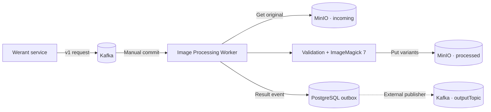

<div align="center">

# WERANT

### Image Processing Worker

**Safe. Idempotent. Event-driven.**

Asynchronous image processing for the Werant ecosystem.

<br />

[](https://go.dev/)
[](https://kafka.apache.org/)
[](https://min.io/)
[](https://www.postgresql.org/)
[](LICENSE)

<br />


</div>

---

## Overview

`werant-image-processing-worker` is a Go worker that consumes requests from
Kafka, validates untrusted images, generates the requested variants with
ImageMagick, and records the result in a PostgreSQL outbox.

Image binaries remain outside Kafka. Messages carry only the processing
contract and object key; originals are read from the configured incoming bucket
and generated variants are written to the configured processed bucket.

The current implementation provides:

- serial consumption with manual commits and rebalances blocked during processing;
- envelope, v1 contract, and object-key validation;
- content-based detection of JPEG, PNG, GIF, and WebP;
- byte, pixel, frame, time, memory, and disk limits;
- centered cropping, proportional downscaling, and per-variant conversion;
- animated GIF and WebP preservation when the output is WebP;
- S3-compatible storage with separate incoming and processed buckets;
- a PostgreSQL outbox with deduplication and per-image locking;
- upload compensation when persistence fails;
- unit tests, real ImageMagick tests, and continuous validation.

> [!NOTE]
> This repository does not publish events to Kafka. It persists the result and
> `output_topic` in the outbox; a separate publisher is responsible for delivery.

## Architecture

### Processing flow



Each record moves through the following stages:

1. validate the JSON syntax and the fields required for routing;
2. acquire the PostgreSQL lock for the `imageId` and look for a previous result;
3. validate the contract, detected format, and file limits;
4. generate every variant locally before starting any upload;
5. write the artifacts to the processed bucket;
6. persist the success or rejection event in the outbox;
7. delete the original and commit the Kafka offset only after completion.

Infrastructure failures stop the consumer without committing the record.
Permanent content failures produce an `IMAGE_PROCESSING_FAILED` event.

### Components

| Component | Responsibility |
| :-- | :-- |
| Kafka | Receive requests and control delivery through offsets |
| MinIO incoming | Keep the original file until processing completes |
| ImageMagick 7 | Crop, resize, compose animations, and encode outputs |
| MinIO processed | Store the final variants |
| PostgreSQL | Serialize work per image, deduplicate requests, and maintain the outbox |
| External publisher | Publish the outbox `payload` to its `output_topic` |

## Repository structure

```text
.
├── .github/workflows/ci.yml          # Quality, tests, and vulnerability checks
├── application
│   ├── ports                         # Storage, processor, and outbox contracts
│   └── usecases                      # Pipeline orchestration and compensation
├── cmd/worker/main.go                # Worker entry point
├── domain
│   ├── patterns                      # Operational limits and supported formats
│   ├── image.go                      # Request, result, and validation rules
│   └── outbox.go                     # Outbox entity
├── infrastructure
│   ├── config                        # Environment configuration
│   ├── dto                           # Kafka contract deserialization
│   ├── messenger                     # Kafka client and consumer
│   ├── processing                    # Inspection, crop, and ImageMagick adapter
│   ├── storage                       # MinIO and PostgreSQL adapters
│   └── worker                        # Bootstrap and process lifecycle
├── observability                     # Cleanup-failure reporting
├── scripts/run-worker.ps1            # Local Windows launcher
├── .env.example
├── go.mod
└── go.sum
```

## Configuration

| Variable | Required | Default | Responsibility |
| :-- | :--: | :-- | :-- |
| `KAFKA_BROKERS` | Yes | — | Comma-separated bootstrap brokers |
| `KAFKA_TOPICS` | Yes | — | Comma-separated input topics |
| `MINIO_ENDPOINT` | Yes | — | S3-compatible endpoint in `host:port` form |
| `MINIO_ACCESS_KEY` | Yes | — | MinIO access key |
| `MINIO_SECRET_KEY` | Yes | — | MinIO secret key |
| `MINIO_SECURE` | No | `false` | Enables TLS for the MinIO connection |
| `MINIO_INCOMING_BUCKET_NAME` | Yes | — | Bucket containing original files |
| `MINIO_PROCESSED_BUCKET_NAME` | Yes | — | Bucket for generated variants; must differ from incoming |
| `POSTGRES_URL` | Yes | — | Connection URL for the worker's dedicated database |
| `POSTGRES_USER` | No | URL value | Overrides the user from `POSTGRES_URL` |
| `POSTGRES_PASSWORD` | No | URL value | Overrides the password from `POSTGRES_URL` |
| `IMAGEMAGICK_BINARY` | No | `magick` | ImageMagick 7 executable name or path |

Use [.env.example](.env.example) as a reference. Never commit real credentials;
`.env` and its local variants are ignored by Git.

## Local development

### Requirements

- Go `1.26` or newer;
- ImageMagick 7 with JPEG, PNG, and WebP delegates;
- reachable Kafka, PostgreSQL, and MinIO services;
- existing, separate incoming and processed MinIO buckets;
- a dedicated database created before the worker starts.

The embedded SQL migration creates the outbox table and index during startup.
The application therefore needs permission to perform that initial DDL.

Export the variables from `.env.example` into the process environment. On
Windows, `scripts/run-worker.ps1` loads `.env` before starting the worker.
`POSTGRES_URL` may contain credentials; when present, `POSTGRES_USER` and
`POSTGRES_PASSWORD` override the corresponding URL values.

### Run and test

```bash
go run ./cmd/worker
go test ./...
```

On Windows:

```powershell
powershell -NoProfile -ExecutionPolicy Bypass -File .\scripts\run-worker.ps1
```

## Continuous integration

The `.github/workflows/ci.yml` workflow runs on pushes, pull requests, and
manual dispatches. It verifies module consistency and formatting, runs
`go vet`, builds the worker, executes tests with the race detector and a real
ImageMagick 7 installation, reports coverage, and checks for known
vulnerabilities with `govulncheck`. It does not publish artifacts or deploy the
service.

Conversion tests use the `magick` binary available on `PATH` and are skipped
locally when it is unavailable. The CI workflow treats such a skip as a failure.

Production deployments should supervise the process with restart backoff.
Infrastructure failures stop the consumer and leave the affected record
uncommitted.

## Input contract v1

```json
{
  "schemaVersion": 1,
  "eventId": "82c8e4ba-d96d-4076-9a73-109c908fd4bc",
  "imageId": "9a071332-a599-4559-b6b9-86d59e12d3e4",
  "ownerId": "9a01c74a-f77b-407a-b424-f570ef72dc03",
  "service": "user",
  "objectKey": "user/9a01c74a-f77b-407a-b424-f570ef72dc03/profile-picture/9a071332-a599-4559-b6b9-86d59e12d3e4",
  "outputTopic": "user.processedImage",
  "maxSizeBytes": 5000000,
  "permittedFormats": ["jpg", "jpeg", "png", "gif", "webp"],
  "outputShape": [
    {"name": "avatar", "maxWidth": 500, "maxHeight": 500, "format": null, "quality": null},
    {"name": "preview", "maxWidth": 250, "maxHeight": 250, "format": "jpg", "quality": 80}
  ]
}
```

- `eventId` and `imageId` must be UUIDs. `ownerId`, `service`, `objectKey`, and
  `outputTopic` are required. The source key is opaque; the worker does not
  enforce a service-specific path expression.
- `name` is required and unique within the request. It must contain 1 to 64
  alphanumeric, `_`, or `-` characters and start with an alphanumeric character.
- An absent or `null` `format` defaults to WebP. JPG and JPEG are normalized to
  `jpeg`, including the file extension. An absent or `null` quality defaults to
  80 for JPEG and WebP; explicit values must be between 1 and 100. PNG ignores
  quality.
- `permittedFormats` restricts input formats, never encoders. The detected input
  format must be listed and supported by the worker. GIF is not a valid output.
- The worker applies a centered crop to the requested aspect ratio. It only
  downsizes and never enlarges an image. Result keys use
  `{objectKey}/{name}/{actualWidth}x{actualHeight}.{format}`.
- Animated GIF and WebP inputs remain animated when encoded as WebP. JPEG and
  PNG outputs use only the first composed frame. JPEG uses a white background
  for transparent pixels.
- Dimensions refer to the encoded canvas. The worker does not apply automatic
  EXIF rotation and strips metadata from every output.

## Processing limits

Limits are defined in `domain/patterns`. Static images may use up to 14,745,600
pixels and an estimated 58,982,400 decoded RGBA bytes. Animated GIF and WebP
canvases may use up to 3,686,400 pixels and an estimated 14,745,600 decoded
RGBA bytes. These values do not represent the process's total memory limit.

Animated outputs use the following frame budget:

```text
frames <= floor(250 * 2,073,600 / (canvasWidth * canvasHeight))
```

Requests with only static outputs neither count nor decode every animation
frame. A mixed request that exceeds the animation budget fails as a whole.

Additional initial operational limits are:

- input files up to 64 MiB, or `maxSizeBytes` when lower;
- up to 16 output variants per request;
- 256 MiB of ImageMagick memory cache;
- no ImageMagick memory mapping;
- 1 GiB of ImageMagick disk cache;
- one ImageMagick thread;
- two minutes per output variant;
- eight minutes for the complete request.

The decoded RGBA budget is independent from the compressed file size. These
engine limits do not replace container-level memory, CPU, or disk limits, and
ImageMagick may allocate additional buffers.

## Result and outbox

The JSONB payload is an object, not a string containing JSON. Common fields are
`schemaVersion`, `eventId`, `requestEventId`, `eventType`, `occurredAt`,
`imageId`, `ownerId`, `service`, `sourceObjectKey`, `outputs`, and `error`.

A successful result uses `IMAGE_PROCESSING_SUCCEEDED`, has `error: null`, and
includes every generated variant:

```json
{
  "name": "avatar",
  "bucket": "processed",
  "objectKey": "user/.../profile-picture/.../avatar/500x500.webp",
  "format": "webp",
  "contentType": "image/webp",
  "width": 500,
  "height": 500,
  "sizeBytes": 48210,
  "animated": false,
  "frameCount": 1
}
```

A permanent failure uses `IMAGE_PROCESSING_FAILED`, has `outputs: []`, and
contains a structured error:

```json
{
  "code": "INPUT_FORMAT_NOT_PERMITTED",
  "stage": "VALIDATION",
  "message": "detected input format is not permitted by the service",
  "outputName": null
}
```

Other error codes are `INVALID_REQUEST`, `UNSUPPORTED_INPUT_FORMAT`,
`UNSUPPORTED_OUTPUT_FORMAT`, `INPUT_TOO_LARGE`, `PIXEL_LIMIT_EXCEEDED`,
`FRAME_LIMIT_EXCEEDED`, `INVALID_IMAGE`, and `IMAGE_PROCESSING_FAILED`.

The table contains `payload`, `output_topic`, and a unique `request_event_id`,
along with the operational outbox fields. `aggregate_id` is the `imageId`,
`aggregate_type` is `IMAGE`, and `id` is the result event ID. Both success and
failure rows begin with `status = PENDING`, `retry_count = 0`, and
`retry_limit = 10`.

Publication and attempt timestamps begin as `null` and belong to the publisher.
`reason` contains the error code when processing fails. This repository does
not implement the publisher.

## Failure handling and idempotency

All variants are generated locally before any upload begins. If one generation
fails, the request produces no partial result. Uploads precede the outbox write.
An upload failure or a confirmed persistence failure triggers an attempt to
delete every written key. The original is deleted only after a success or
rejection result has been persisted. Infrastructure failures do not produce
processing-failure events.

If the database response is lost, the worker looks up `request_event_id` before
compensating. When it cannot determine whether the write committed, it retains
the objects and leaves the Kafka message uncommitted until reconciliation.
Deleting objects in that state could invalidate an event that was already
persisted.

Compensation failures are reported and may leave orphaned objects. A future
reconciliation process is still required for abrupt process termination.

The consumer processes one record at a time, blocks rebalances while work is in
progress, and commits explicitly only after processing and cleanup complete.
PostgreSQL locks each `imageId` across replicas, while `eventId` provides
deduplication.

Services must treat each `imageId` and `objectKey` pair as an immutable image
and retry the same request with the same `eventId`. Changing the request while
retaining its identity is not a supported update operation.

Malformed JSON or an envelope without a valid identity and output topic cannot
be routed safely. The worker stops without committing that message. An
operational quarantine or dead-letter policy must handle this case without
inventing a response topic.

Syntactically valid JSON that does not match contract v1 becomes a processing
failure when `eventId`, `imageId`, and `outputTopic` remain valid. The worker
writes `INVALID_REQUEST` to the outbox and does not access MinIO when no safe
object key exists. Syntactically invalid JSON still requires routing outside
the payload, such as Kafka headers or a fixed rejection topic.

Failures while closing objects, removing temporary directories, rolling back
uploads, or releasing locks produce structured logs containing `component`,
`error`, and the cumulative `cleanup_failures_total` counter. The counter resets
with the process; a log backend can convert it into an alert without adding an
HTTP port to the worker.

Adapter references: [ImageMagick command-line options](https://imagemagick.org/command-line-options/),
[ImageMagick WebP](https://imagemagick.org/webp/), and the
[franz-go consumer API](https://pkg.go.dev/github.com/twmb/franz-go/pkg/kgo).

## Implementation status

- [x] v1 input contract and routing validation.
- [x] Kafka consumer with explicit commits and rebalance protection.
- [x] JPEG, PNG, GIF, and WebP input formats.
- [x] JPEG, PNG, and WebP output formats.
- [x] Animated GIF and WebP preservation in WebP outputs.
- [x] Separate buckets for originals and processed variants.
- [x] PostgreSQL outbox, idempotency, and per-`imageId` locking.
- [x] Upload rollback and ambiguous-commit reconciliation.
- [x] CI with builds, race detection, coverage, and `govulncheck`.
- [ ] Quarantine or dead-letter policy for unroutable envelopes.
- [ ] Automatic reconciliation of orphaned objects after abrupt termination.
- [ ] Persistent metrics and operational alerts.
- [ ] Container image and deployment manifests.

## License

This project is licensed under the [MIT License](LICENSE).

Copyright (c) 2026 Leonardo Leal.

## Engineering philosophy

Werant's media pipeline follows a simple principle:

**Untrusted inputs should cross explicit boundaries before consuming expensive
resources or producing permanent side effects.**

Messages remain small, formats are detected from content, every variant is
prepared before uploads begin, and offsets are committed only after storage,
outbox, and cleanup reach a reconcilable state.

---

<div align="center">

**WERANT / IMAGE PROCESSING WORKER**

_Built for resilient media pipelines._

<sub>Go · Kafka · MinIO · PostgreSQL · ImageMagick</sub>

</div>
